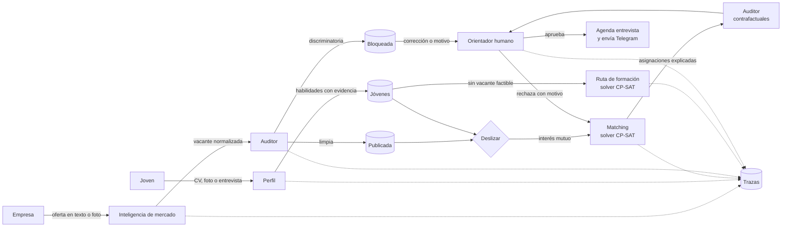

# Empleo Joven — sistema de agentes para la inserción laboral juvenil

Hackathon FISC 2026 · Reto 3: Empleabilidad · Universidad Tecnológica de Panamá

> **Estado:** versión de trabajo. Las secciones marcadas *(en desarrollo)* se completan
> durante el evento.

## El problema

La transición del estudio al primer empleo es uno de los momentos más difíciles para los
jóvenes panameños, y el problema es de información en tres lados:

- **Jóvenes:** no saben qué habilidades pide el mercado, cómo traducir su experiencia
  informal (el negocio familiar, un voluntariado) al lenguaje de una empresa, ni qué curso
  gratuito cierra su brecha. Envían CVs de forma masiva sin respuesta.
- **Empresas:** reciben cientos de postulaciones que no encajan y a veces publican ofertas
  con requisitos discriminatorios ("buena presencia", límites de edad).
- **Centros de formación:** sus cursos no siempre llegan a quien más los necesita.

Y la geografía: una vacante en Tocumen puede ser inviable para alguien de La Chorrera por
las horas de traslado y el costo del pasaje, algo que los portales de empleo ignoran.

## La solución

Un mercado de tres lados con la mecánica de "deslizar": el joven ve vacantes y la empresa
ve candidatos anonimizados; cada uno dice sí o no. **Pero quien decide no es un modelo de
lenguaje: son solvers y reglas en código**, y una persona (el orientador) aprueba cada
decisión importante.

- Cada tarjeta explica por qué aparece: habilidades que coinciden, minutos y costo de
  traslado, y salario neto del transporte.
- Las vacantes imposibles para un joven (por distancia, presupuesto, horario o salario)
  ni siquiera se le muestran, y el sistema dice por qué.
- Cuando hay interés mutuo, un solver de optimización asigna respetando los cupos.
- El orientador aprueba; el sistema agenda la entrevista y avisa por Telegram.
- Quien no tiene ninguna vacante posible recibe una ruta de cursos que cabe en su horario,
  su presupuesto y su transporte.
- Un auditor bloquea ofertas discriminatorias y mide si el resultado cambia al cambiar
  solo el nombre, el género o el corregimiento de una persona.

## Arquitectura



El **orquestador** (`orquestador/flujo.py`) conecta los agentes. Se comunican con modelos
tipados (`contrato/modelos.py`) y cada decisión queda registrada en la tabla `trazas`
(qué agente, qué acción, entrada, salida y motivo).

### Agentes

| Agente | Qué hace | Cómo decide | Estado |
|---|---|---|---|
| **Inteligencia de mercado** | Normaliza ofertas a una taxonomía de habilidades y extrae tendencias | El LLM extrae; el código valida contra la taxonomía | *(en desarrollo)* |
| **Perfil** | Lee el CV (PDF o foto) y hace una entrevista corta para descubrir habilidades no declaradas | El LLM extrae con esquema estricto; cada habilidad lleva su evidencia | *(en desarrollo)* |
| **Matching** | Filtra pares imposibles, puntúa y asigna con cupos | Reglas + OR-Tools CP-SAT | Listo |
| **Ruta de formación** | Elige cursos que cierran la brecha de habilidades | OR-Tools CP-SAT con cupos, turnos, traslado y presupuesto | Listo |
| **Auditor** | Bloquea ofertas discriminatorias y hace pruebas contrafactuales de sesgo | Reglas determinísticas; el LLM solo como segunda opinión | *(en desarrollo)* |

### Requisitos mínimos del reto

| Requisito | Cómo se cumple |
|---|---|
| Arquitectura multiagente (≥3) | 5 agentes con roles distintos, coordinados por el orquestador |
| Herramientas que actúan | Escriben en SQLite, agendan entrevistas y envían mensajes por Telegram |
| Componente determinístico | Factibilidad, puntaje, asignación y ruta de cursos son código (`agentes/matching`, `agentes/formacion`) |
| Humano en el ciclo | El orientador aprueba o rechaza cada asignación (rechazar exige motivo) y decide sobre ofertas bloqueadas |
| Explicabilidad | Cada asignación trae su desglose (habilidades, traslado, salario) y sus motivos en texto |
| Trazabilidad | Tabla `trazas` y endpoint `GET /trazas?agente=` |
| Evals (≥15 casos) | *(en desarrollo)* en `evals/` |
| Guardrails | Validación estricta de toda entrada; textos de más de 5000 caracteres se rechazan antes del LLM; el texto de CVs y ofertas se trata como dato, nunca como instrucción; la empresa nunca recibe datos personales |

### Decisiones de diseño

- **Los datos personales viven aparte.** `Joven` no tiene nombre, género ni edad; esos
  campos están en `DatosPersonales`. Los solvers reciben solo `Joven`, así que no pueden
  usarlos aunque quisieran.
- **El puntaje separa lo geográfico.** El corregimiento solo puede mover los componentes
  de traslado y salario neto; el de habilidades no depende del lugar. Así el Auditor puede
  distinguir una diferencia legítima (vive lejos) de un sesgo.
- **Óptimo global, no voraz.** Asignar a cada joven su mejor opción en orden puede dejar a
  alguien sin trabajo; el solver maximiza el total respetando cupos (hay una prueba que lo
  demuestra: `test_optimo_global_gana_al_voraz`).
- **Resultados reproducibles.** Los solvers corren con semilla fija y un solo hilo.

## Tecnologías

- **Backend:** Python 3.12+, FastAPI, Pydantic 2, SQLite.
- **Optimización:** Google OR-Tools (CP-SAT).
- **Modelo de lenguaje:** Groq (`openai/gpt-oss-120b`), solo para extraer datos de texto e
  imágenes *(en desarrollo)*.
- **Mensajería:** API de bots de Telegram.
- **Frontend:** React + Vite *(en desarrollo)*.
- **Pruebas:** pytest.

## Fuentes de datos

- **Datos de demostración** (`scripts/demo/datos_demo.json`): **ilustrativos**. Tiempos y
  tarifas de traslado aproximados entre 8 corregimientos; cursos inspirados en la oferta de
  INADEH; personas y empresas ficticias.
- **Datos reales** *(en desarrollo)* en `datos/`: ofertas de portales panameños, catálogo de
  cursos de INADEH y tarifas de transporte, cada uno con su fuente y fecha de consulta.

## Instalación y ejecución

```bash
git clone <url-del-repositorio> && cd <carpeta>
python3 -m venv .venv
.venv/bin/pip install -r requirements.txt
cp .env.example .env            # opcional: claves de Groq y Telegram

# Datos de demostración (10 vacantes, 10 jóvenes, 8 cursos) y primera corrida del matching
.venv/bin/python scripts/semilla_demo.py --reiniciar --matching

# API en http://localhost:8010 (documentación interactiva en /docs)
.venv/bin/uvicorn api.main:app --reload --port 8010

# Pruebas
.venv/bin/python -m pytest
```

### Credenciales de demo

La demo no requiere usuario ni contraseña. Las claves son opcionales y van en `.env`
(nunca en el repositorio; ver `.env.example`):

| Variable | Para qué | Sin ella |
|---|---|---|
| `GROQ_API_KEY` | Extracción de CVs y ofertas | Mercado y Perfil no procesan texto libre |
| `TELEGRAM_BOT_TOKEN`, `TELEGRAM_CHAT_ID_DEMO` | Envío real del aviso de entrevista | El mensaje queda registrado en la base pero no se envía |
| `RUTA_BASE_DATOS` | Archivo SQLite | Usa `datos_app.db` |
| `ORIGENES_PERMITIDOS` | Orígenes del frontend (CORS) | `http://localhost:5173` |

## API

| Método | Ruta | Qué hace |
|---|---|---|
| `POST` | `/jovenes` | Registra un joven y sus datos personales |
| `GET` | `/jovenes/{id}/tarjetas` | Vacantes factibles para deslizar, con explicación |
| `GET` | `/jovenes/{id}/plan` | Ruta de formación |
| `POST` | `/ofertas` | Publica una oferta en texto libre (Mercado → Auditor) |
| `POST` | `/vacantes` | Publica una vacante estructurada (Auditor) |
| `GET` | `/vacantes/{id}/tarjetas` | Candidatos factibles, sin datos personales |
| `POST` | `/vacantes/{id}/publicar-bloqueada` | El orientador publica una oferta bloqueada, con motivo |
| `POST` | `/deslizar` | Registra un sí o un no; responde si hay interés mutuo |
| `POST` | `/matching` | Corre el matching y la ruta de formación |
| `GET` | `/asignaciones` | Filtra por `pendiente`, `aprobada` o `rechazada` |
| `POST` | `/asignaciones/{joven}/{vacante}/decision` | El orientador aprueba o rechaza |
| `GET` | `/trazas` | Qué agente decidió qué, filtrable por agente |
| `GET` | `/mensajes` | Mensajes enviados o registrados |
| `GET` | `/salud` | Qué agentes están conectados |

Errores: `404` si algo no existe, `400` si una regla del flujo no lo permite (con el motivo
en `detail`), `422` si los datos no son válidos.

## Estructura

```
contrato/       modelos de datos compartidos por todos los agentes
orquestador/    flujo, almacenamiento SQLite, trazas, agenda y notificaciones
agentes/        matching/, formacion/ (y mercado/, perfil/, auditor/)
api/            API HTTP (FastAPI)
scripts/        datos de demostración y utilidades
tests/          pruebas automáticas
```

## Pruebas

93 pruebas automáticas cubren el contrato, el Matching, la Ruta de formación, el
orquestador, la API y la historia de los datos de demostración. Además, cada restricción
de los solvers se verificó quitándola a propósito y comprobando que alguna prueba falla.

**Carga y concurrencia** (`scripts/prueba_carga.py`, contra la API en ejecución): más de
1000 peticiones en ráfagas de hasta 378 simultáneas, mezclando registros, deslizamientos,
10 corridas de matching a la vez, decisiones del orientador enviadas dos veces en paralelo
y entradas maliciosas (inyección de prompt, SQL, textos gigantes, datos inválidos).
Resultado: 0 errores 5xx; ninguna vacante supera sus cupos, ningún joven queda con dos
asignaciones y ninguna decisión se aplica dos veces.

```bash
.venv/bin/python scripts/semilla_demo.py --reiniciar --base carga.db
RUTA_BASE_DATOS=carga.db .venv/bin/uvicorn api.main:app --port 8010
.venv/bin/python scripts/prueba_carga.py --url http://localhost:8010 --jovenes 300
```

## Equipo

**LarpeoIntenso**
