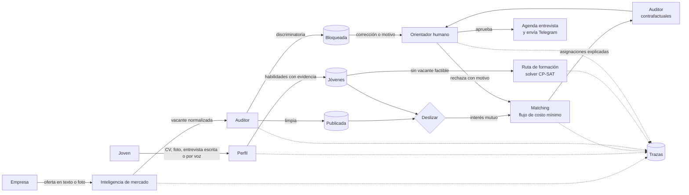

# Empleo Joven — sistema de agentes para la inserción laboral juvenil

Hackathon FISC 2026 · Reto 3: Empleabilidad · Universidad Tecnológica de Panamá

> **Estado:** versión de entrega del Hackathon FISC 2026 (tag `final-24h`).

## El problema

La transición del estudio al primer empleo es uno de los momentos más difíciles para los
jóvenes panameños, y el problema es de información en tres lados:

- **Jóvenes:** no saben qué habilidades pide el mercado, cómo traducir su experiencia
  informal (el negocio familiar, un voluntariado) al lenguaje de una empresa, ni qué curso
  gratuito cierra su brecha. Envían CVs de forma masiva sin respuesta.
- **Empresas:** reciben cientos de postulaciones que no encajan y a veces publican ofertas
  con requisitos discriminatorios ("buena presencia", límites de edad).
- **Centros de formación:** sus cursos no siempre llegan a quien más los necesita.

Y la geografía: una vacante en Tocumen puede ser inviable para alguien de La Chorrera por
las horas de traslado y el costo del pasaje, algo que los portales de empleo ignoran.

## La solución

Un mercado de tres lados con la mecánica de "deslizar": el joven ve vacantes y la empresa
ve candidatos anonimizados; cada uno dice sí o no. **Pero quien decide no es un modelo de
lenguaje: son solvers y reglas en código**, y una persona (el orientador) aprueba cada
decisión importante.

- Cada tarjeta explica por qué aparece: habilidades que coinciden, minutos y costo de
  traslado, y salario neto del transporte.
- Las vacantes imposibles para un joven (por distancia, presupuesto, horario o salario)
  ni siquiera se le muestran, y el sistema dice por qué.
- **Casi califica:** las vacantes donde le falta una sola cosa se le muestran aparte, con
  cuánto le falta ("le faltan B/.1.00 por semana para el pasaje") y qué hacer; si lo que
  falta es una habilidad, el curso que la cubre y que cabe en su horario y presupuesto.
- Cuando hay interés mutuo, un solver de optimización asigna respetando los cupos.
- **Autonomía:** el sistema no espera un clic. Al haber interés mutuo o publicarse una vacante,
  corre el matching solo; a un joven nuevo sin ninguna vacante a su alcance le arma su ruta de
  formación al registrarse. Cada reacción queda trazada (`auto_matching`) y las propuestas
  siguen esperando la aprobación del orientador.
- **Pesos ajustables:** el orientador decide cuánto pesan habilidades, traslado y salario
  (con límites: ninguno puede anularse ni dominar del todo). Antes de cambiarlos puede
  simular qué propuestas entrarían y cuáles saldrían; cada cambio queda trazado con su motivo.
- El orientador aprueba; el sistema agenda la entrevista y avisa por Telegram.
- **Reacomodo:** si un joven cancela o no se presenta, si la empresa lo retira o si cierra
  la vacante, el cupo se libera y el solver propone de inmediato al siguiente candidato
  (o reubica al joven en otra vacante), siempre con aprobación del orientador. Las
  entrevistas se pueden reprogramar y cada cambio se avisa.
- Quien no tiene ninguna vacante posible recibe una ruta de cursos que cabe en su horario,
  su presupuesto y su transporte.
- Un auditor bloquea ofertas discriminatorias y mide si el resultado cambia al cambiar
  solo el nombre, el género o el corregimiento de una persona.

## Arquitectura



El **orquestador** (`orquestador/flujo.py`) conecta los agentes. Se comunican con modelos
tipados (`contrato/modelos.py`) y cada decisión queda registrada en la tabla `trazas`
(qué agente, qué acción, entrada, salida y motivo).

### Agentes

| Agente | Qué hace | Cómo decide | Estado |
|---|---|---|---|
| **Inteligencia de mercado** | Normaliza ofertas en texto libre a una taxonomía de habilidades y extrae tendencias por zona | El LLM extrae con esquema estricto (sin LLM, por palabras clave); el código valida contra la taxonomía y el contrato, y avisa qué campos faltan | Listo |
| **Perfil** | Lee el CV (PDF, foto o texto) y hace una entrevista corta, escrita o por nota de voz, para descubrir habilidades no declaradas; también lee fotos de volantes de ofertas | El LLM solo propone; el código acepta una habilidad solo si existe en la taxonomía y su cita aparece en el texto original; la experiencia informal llega como máximo a nivel 2; sin LLM funciona con palabras clave | Listo |
| **Matching** | Filtra pares imposibles, puntúa y asigna con cupos | Reglas + OR-Tools (flujo de costo mínimo: óptimo exacto en tiempo polinomial) | Listo |
| **Ruta de formación** | Elige cursos que cierran la brecha de habilidades | OR-Tools CP-SAT con cupos, turnos, traslado y presupuesto | Listo |
| **Auditor** | Bloquea ofertas discriminatorias y hace pruebas contrafactuales de sesgo en cada matching | Solo reglas en código, sin LLM: patrones con manejo de negaciones y contexto; los contrafactuales se recalculan con el código real del Matching | Listo |

### Requisitos mínimos del reto

| Requisito | Cómo se cumple |
|---|---|
| Arquitectura multiagente (≥3) | 5 agentes con roles distintos, coordinados por el orquestador |
| Herramientas que actúan | Escriben en SQLite, agendan entrevistas y envían mensajes por Telegram |
| Componente determinístico | Factibilidad, puntaje, asignación y ruta de cursos son código (`agentes/matching`, `agentes/formacion`) |
| Humano en el ciclo | El orientador aprueba o rechaza cada asignación (rechazar exige motivo), decide sobre ofertas bloqueadas y ajusta los pesos del puntaje después de simular su efecto |
| Explicabilidad | Cada asignación trae su desglose (habilidades, traslado, salario) y sus motivos en texto |
| Trazabilidad | Tabla `trazas`, `GET /trazas?agente=` y la historia de cada joven de punta a punta (`GET /jovenes/{id}/historia`) |
| Evals (≥15 casos) | 40 casos en `evals/` (Matching, Auditor, Mercado) y 43 del agente Perfil en `agentes/perfil/evals/` (extracción, validación de lo que propone el LLM y guardrails, con modo en vivo); resultados en `evals/resultados.md` y `agentes/perfil/evals/resultados.md` |
| Guardrails | Límites de forma y tamaño en todo el contrato (ids sin caracteres que rompan la URL, nombres, textos y listas con tope); tokens por rol: cada actor solo toca lo suyo y las decisiones clave son del orientador; validación estricta de toda entrada; textos de más de 5000 caracteres se rechazan antes del LLM; el texto de CVs y ofertas se trata como dato, nunca como instrucción; la empresa nunca recibe datos personales |

### Decisiones de diseño

- **Los datos personales viven aparte.** `Joven` no tiene nombre, género ni edad; esos
  campos están en `DatosPersonales`. Los solvers reciben solo `Joven`, así que no pueden
  usarlos aunque quisieran. La empresa ve habilidades y niveles **sin la evidencia textual**
  del CV, que puede traer nombre, cédula o teléfono (hay una prueba que lo verifica con un
  CV real de ejemplo).
- **El puntaje separa lo geográfico.** El corregimiento solo puede mover los componentes
  de traslado y salario neto; el de habilidades no depende del lugar. Así el Auditor puede
  distinguir una diferencia legítima (vive lejos) de un sesgo.
- **Óptimo global, no voraz.** Asignar a cada joven su mejor opción en orden puede dejar a
  alguien sin trabajo; el solver maximiza el total respetando cupos (hay una prueba que lo
  demuestra: `test_optimo_global_gana_al_voraz`).
- **Resultados reproducibles.** Los modelos se construyen siempre en el mismo orden y CP-SAT corre con semilla fija y un solo hilo.
- **Los avisos no frenan al sistema.** Los mensajes de Telegram se envían después de soltar
  el candado del orquestador; un canal lento o caído no bloquea las demás operaciones ni
  deshace la aprobación ya guardada.
- **Rendimiento.** El Matching es un flujo de costo mínimo (exacto y polinomial; antes CP-SAT,
  que con miles de pares agotaba su límite de tiempo sin solución). El solver trabaja solo con
  el puntaje numérico y la explicación se arma únicamente para los pares elegidos. Con 2000
  jóvenes y 200 vacantes, el ciclo completo de matching tarda unos 0,3 s, y la asignación
  con todos los pares posibles (5000 × 300) unos 7 s.

## Tecnologías

- **Backend:** Python 3.12+, FastAPI, Pydantic 2, SQLite.
- **Optimización:** Google OR-Tools: flujo de costo mínimo para el Matching y CP-SAT para la Ruta de formación.
- **Modelo de lenguaje:** Groq, solo para extraer datos y redactar: `openai/gpt-oss-120b` (texto),
  `qwen/qwen3.8-27b` (fotos de CV y volantes) y `whisper-large-v3-turbo` (notas de voz).
- **Mensajería:** API de bots de Telegram.
- **Frontend:** React + Vite; mapa y gráficos en SVG propio, sin librerías extra.
- **Pruebas:** pytest.

## La página

Una sola página (`frontend/`, en `http://localhost:5173`) con una vista por rol; el selector de
arriba cambia de rol en un clic durante la demo y el botón ☀️/🌙 elige tema claro u oscuro.

- **Joven:** registro con CV (PDF, foto o texto) o entrevista escrita o por **nota de voz**;
  tarjetas para deslizar que dicen en palabras cuánto le queda después del pasaje y cuántos
  minutos tarda; "de 11 vacantes publicadas, 5 le sirven" con un **mapa** de su casa y cada
  vacante; "Le falta poco", "Cursos" (con cupo reservado por un centro) y "Mi proceso" con los
  pasos y sus entrevistas (cambiar fecha o cancelar).
- **Empresa:** publicar con formulario, pegando el texto o el mensaje de WhatsApp, o con la
  **foto del volante**; ver y corregir lo que bloquea el Auditor; candidatos anónimos para
  deslizar; personas en proceso; cerrar vacantes.
- **Centro de formación:** sus cursos, cupos y los jóvenes que los necesitan en el orden del
  sistema; reservar cupos.
- **Orientador:** tablero **Panorama** (cifras, mapa por corregimiento, por qué se descartan las
  combinaciones, lo que piden las empresas y "lo que el sistema hizo solo"), propuestas para
  aprobar o rechazar, ofertas bloqueadas, jóvenes sin opción, prioridades del puntaje con
  simulación, **auditoría contrafactual** e historial de decisiones.

El mapa ubica cada corregimiento con las coordenadas de `datos/corregimientos.csv`
(OpenStreetMap, © colaboradores de OpenStreetMap, con fuente por fila; ver
`datos/FUENTES_CORREGIMIENTOS.md`). La Chorrera y San Miguelito, que en los datos de demostración
son distritos y no tienen un punto único, se dibujan aproximados y con borde punteado; la costa y
el Canal son trazos simplificados. Los tiempos y costos de viaje salen de la tabla de traslados.

## Fuentes de datos

- **Datos de demostración** (`scripts/demo/datos_demo.json`): **ilustrativos**. Tiempos y
  tarifas de traslado aproximados entre 8 corregimientos; cursos inspirados en la oferta de
  INADEH; personas y empresas ficticias.
- **Datos reales** en `datos/`, cada registro con su fuente, URL y fecha de consulta
  (16/10/2026):
  - **30 ofertas de empleo** de portales panameños (EstasContratado, Computrabajo, CazVid,
    Canal de Panamá, Bolsa de Trabajo de la UTP, Hiringroom): 22 verificadas y 8 parciales
    (`ofertas_empleo.csv`, `FUENTES_OFERTAS.md`).
  - **28 cursos** gratuitos o de bajo costo: INADEH (18), Cisco Networking Academy (6) y
    Oracle (4) (`cursos.csv`, `FUENTES.md`).
  - **Transporte:** 1104 filas de tiempo y costo entre 24 corregimientos (`transporte.csv`,
    `FUENTES_TRANSPORTE.md`) y coordenadas para el mapa (`corregimientos.csv`,
    `FUENTES_CORREGIMIENTOS.md`).

## Instalación y ejecución

**Demo con un solo comando** (carga los datos de demostración, levanta la API y la página, y
Ctrl+C apaga todo):

```bash
scripts/demo.sh            # --sin-reiniciar conserva la base; --ayuda muestra las opciones
```

Paso a paso:

```bash
git clone <url-del-repositorio> && cd <carpeta>
python3 -m venv .venv
.venv/bin/pip install -r requirements.txt
cp .env.example .env            # opcional: claves de Groq y Telegram

# Datos de demostración (12 vacantes, 11 jóvenes, 8 cursos) y primera corrida del matching
.venv/bin/python scripts/semilla_demo.py --reiniciar --matching

# API en http://localhost:8010 (documentación interactiva en /docs)
.venv/bin/uvicorn api.main:app --reload --port 8010 --timeout-keep-alive 30

# Pruebas
.venv/bin/python -m pytest
```

### Credenciales de demo

La API usa tokens por rol (`Authorization: Bearer <token>`). El script de datos de
demostración crea estos, **predecibles a propósito y solo para la demo**:

| Rol | Token | Qué puede hacer |
|---|---|---|
| Orientador | `demo-orientador` (o el valor de `CLAVE_ORIENTADOR`) | Todo: matching, aprobar o rechazar, inasistencias, ofertas bloqueadas, trazas |
| Joven | `demo-j01` … `demo-j11` (`demo-j11` = Lucía, sin deslizar nada: para la demo en vivo) | Solo lo suyo: perfil, tarjetas, plan, casi califica, deslizar, cancelar, reprogramar |
| Centro de formación | `demo-inadeh` | Ver quién necesita cada curso y reservar cupos |
| Empresa | `demo-e_super`, `demo-e_call`, `demo-e_logis`, `demo-e_resto`, `demo-e_tienda`, `demo-e_tec`, `demo-e_agencia`, `demo-e_hotel` | Solo sus vacantes: publicar, ver candidatos anonimizados, deslizar, retirar, cerrar |

Un joven nuevo que se registra con `POST /jovenes` recibe su propio token aleatorio en la
respuesta. Los tokens de empresa nuevos los emite el orientador con `POST /credenciales`.
En la base solo se guarda el hash SHA-256 de cada token. En `/docs`, el botón
**Authorize** permite probar la API con cualquiera de estos tokens.

Las claves de servicios externos son opcionales y van en `.env` (nunca en el repositorio;
ver `.env.example`):

| Variable | Para qué | Sin ella |
|---|---|---|
| `GROQ_API_KEY` | Extracción de CVs y ofertas | Mercado y Perfil no procesan texto libre |
| `TELEGRAM_BOT_TOKEN`, `TELEGRAM_CHAT_ID_DEMO` | Envío real del aviso de entrevista. Un bot solo puede escribir a un chat numérico que ya le habló; si el envío al joven falla, el aviso va al chat de la demo indicando para quién era | El mensaje queda registrado en la base pero no se envía |
| `CLAVE_ORIENTADOR` | Token del orientador fuera de la demo | Solo existe `demo-orientador` si se cargaron los datos de demo |
| `RUTA_BASE_DATOS` | Archivo SQLite | Usa `datos_app.db` |
| `ORIGENES_PERMITIDOS` | Orígenes del frontend (CORS) | `http://localhost:5173` |
| `LIMITE_ANONIMO_POR_MINUTO` | Tope por IP para el registro y el Perfil sin token | 30 |

**Un solo proceso.** Levante uvicorn con un solo worker (como en los comandos de arriba). La
decisión del orientador es atómica en la base aunque haya varios procesos, pero el candado del
orquestador, el límite de peticiones y la caché de traslados son por proceso. Detrás de un proxy,
agregue `--proxy-headers` para que el límite use la IP real del cliente.

## API

| Método | Ruta | Qué hace |
|---|---|---|
| `GET` | `/perfil/preguntas` | Preguntas de la entrevista corta (público) |
| `POST` | `/perfil/cv` | CV en PDF, foto o texto → habilidades con evidencia; de un PDF o foto devuelve también `texto_leido` para mostrar de dónde salió cada una (público, no guarda nada) |
| `POST` | `/perfil/entrevista` | Respuestas de la entrevista → habilidades con evidencia (público, no guarda nada) |
| `POST` | `/perfil/declarar` | Habilidad que el joven agrega a mano `{codigo, evidencia}`: solo de la taxonomía, nivel básico y marcada «Según la persona» (público) |
| `POST` | `/perfil/transcribir` | Nota de voz o foto (CV o volante) → texto para que la persona lo revise; no decide nada (público) |
| `POST` | `/jovenes` | Registra un joven y sus datos personales |
| `GET` | `/jovenes/{id}/tarjetas` | Vacantes factibles para deslizar, con explicación |
| `GET` | `/jovenes/{id}/plan` | Ruta de formación |
| `GET` | `/jovenes/{id}/historia` | Todo lo que el sistema hizo con el joven: estado actual y qué agente decidió qué, en orden |
| `GET` | `/jovenes/{id}/casi-califica` | Vacantes donde le falta una sola cosa, con sugerencia y cursos |
| `POST` | `/ofertas` | Publica una oferta en texto libre (Mercado → Auditor) |
| `POST` | `/vacantes` | Publica una vacante estructurada (Auditor) |
| `GET` | `/vacantes/{id}/tarjetas` | Candidatos factibles, sin datos personales |
| `POST` | `/vacantes/{id}/publicar-bloqueada` | El orientador publica una oferta bloqueada, con motivo |
| `POST` | `/deslizar` | Registra un sí o un no; responde si hay interés mutuo |
| `POST` | `/matching` | Corre el matching y la ruta de formación |
| `GET` | `/asignaciones` | Filtra por `pendiente`, `aprobada`, `rechazada` o `cerrada` |
| `POST` | `/asignaciones/{joven}/{vacante}/decision` | El orientador aprueba o rechaza |
| `POST` | `/asignaciones/{joven}/{vacante}/liberar` | Cancelación, inasistencia o retiro: libera el cupo y propone reemplazo |
| `POST` | `/asignaciones/{joven}/{vacante}/reprogramar` | Mueve la entrevista al siguiente espacio libre |
| `POST` | `/vacantes/{id}/cerrar` | Cierra la vacante y reubica a los afectados |
| `GET` | `/impacto` | Cifra de impacto: de todos los pares joven–vacante, cuántos son viables y cuántos se descartan por cada motivo (orientador) |
| `GET` | `/jovenes/{id}/impacto` | Lo mismo para un joven (él mismo u orientador) |
| `GET` | `/centros/{centro}/demanda` | Por curso: quiénes lo necesitan (plan de formación o casi califica), en orden determinístico, sin datos personales (centro u orientador) |
| `POST` | `/cursos/{curso}/reservas` | El centro reserva un cupo: lo descuenta, deja traza y avisa al joven |
| `GET` | `/mercado/tendencias` | Habilidades más pedidas por zona entre las vacantes publicadas (agente de Mercado, público) |
| `GET` | `/auditoria/contrafactual/{joven}` | El mismo joven en cada corregimiento: solo cambian traslado y salario; veredicto del Auditor (orientador) |
| `GET` | `/pesos` | Pesos actuales del puntaje (público) |
| `POST` | `/pesos/simular` | Qué propuestas entrarían y saldrían con otros pesos, sin guardar nada (orientador) |
| `PUT` | `/pesos` | El orientador cambia los pesos, con motivo |
| `GET` | `/planes` | Todos los planes de formación de una vez (orientador) |
| `GET` | `/trazas` | Qué agente decidió qué, filtrable por agente |
| `GET` | `/mensajes` | Mensajes enviados o registrados |
| `GET` | `/salud` | Qué agentes están conectados |
| `GET` | `/yo` | Rol y sujeto del token |
| `POST` | `/credenciales` | El orientador emite un token de empresa, joven u orientador |

Cada respuesta trae `X-Id-Peticion`; un error inesperado responde `500` con `id_error` (el mismo
id queda en el log con la traza completa, sin exponer detalles al cliente). Errores: `429` si un
cliente sin token se pasa del límite (con `Retry-After`), `401` sin token o token inválido, `403` sin permiso para esa acción, `404` si algo
no existe, `400` si una regla del flujo no lo permite (con el motivo en `detail`), `422` si
los datos no son válidos. Públicas (sin token): `/salud`, `/habilidades`, `/cursos`,
`/traslados`, vacantes publicadas y el registro de un joven nuevo.

## Estructura

```
contrato/       modelos de datos compartidos por todos los agentes
orquestador/    flujo, almacenamiento SQLite, trazas, agenda y notificaciones
agentes/        matching/, formacion/ (y mercado/, perfil/, auditor/)
api/            API HTTP (FastAPI)
scripts/        datos de demostración y utilidades
tests/          pruebas automáticas
```

## Pruebas

464 pruebas automáticas cubren el contrato, el Matching, la Ruta de formación, el
orquestador, el agente Perfil, los pesos ajustables, el reacomodo, "casi califica", la historia por joven, los permisos por rol, la API y la historia de los datos de demostración. Además, cada restricción
de los solvers se verificó quitándola a propósito y comprobando que alguna prueba falla.

**Casos aleatorios** (Hypothesis, `tests/test_propiedades.py` y `tests/test_estados.py`):
miles de mercados, perfiles y cursos generados al azar verifican propiedades que deben
cumplirse siempre. En instancias pequeñas, el Matching y la Ruta de formación se comparan
contra una búsqueda exhaustiva de todas las combinaciones: el solver nunca pierde. Una
máquina de estados inventa recorridos completos (registrar, deslizar, matching, aprobar,
cancelar, cerrar, reprogramar, editar) y revisa las reglas del negocio después de cada
paso. Estas pruebas encontraron 6 errores que los ejemplos fijos no veían (por ejemplo,
una propuesta que seguía viva después de que la empresa cambió su respuesta a "no"); cada
uno quedó corregido y fijado en `tests/test_regresiones.py`.

**Antes de entregar:** `scripts/verificar_entrega.sh` corre pruebas, evals y compilación del
frontend, revisa la higiene del repositorio y lista los entregables del reglamento con lo que
falta (`--rapido` omite pruebas y evals).

**Carga y concurrencia** (`scripts/prueba_carga.py`, contra la API en ejecución): más de
1000 peticiones en ráfagas de hasta 378 simultáneas, mezclando registros, deslizamientos,
10 corridas de matching a la vez, decisiones del orientador enviadas dos veces en paralelo
entradas maliciosas (inyección de prompt, SQL, textos gigantes, datos inválidos) y acciones
sin token. Resultado: 0 errores 5xx; todas las acciones sin token rechazadas; ninguna vacante supera sus cupos, ningún joven queda con dos
asignaciones y ninguna decisión se aplica dos veces.

```bash
.venv/bin/python scripts/semilla_demo.py --reiniciar --base carga.db
RUTA_BASE_DATOS=carga.db .venv/bin/uvicorn api.main:app --port 8010 --timeout-keep-alive 30
.venv/bin/python scripts/prueba_carga.py --url http://localhost:8010 --jovenes 300
```

## Equipo

**LarpeoIntenso**
